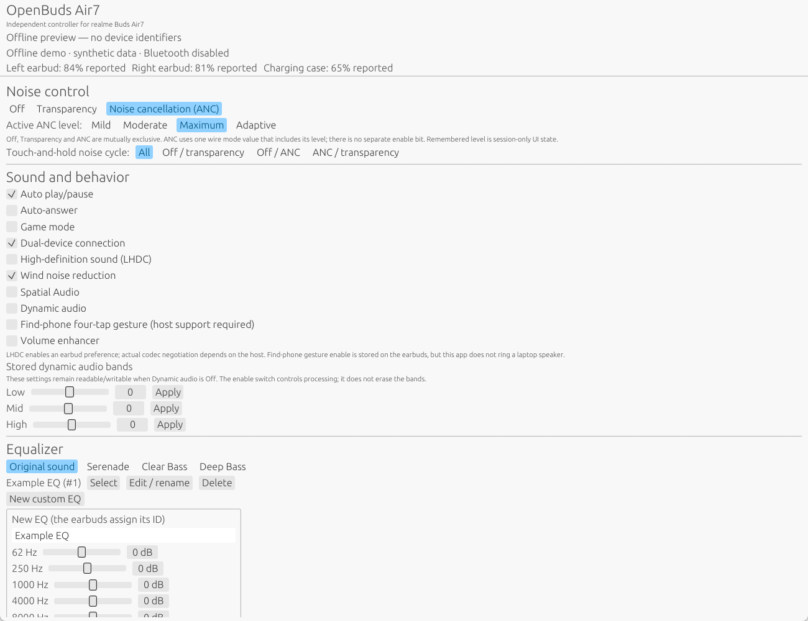
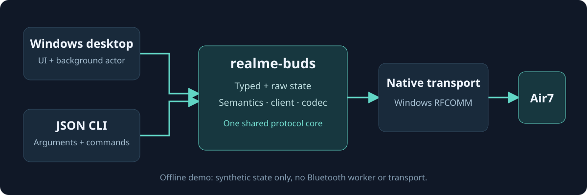

# OpenBuds Air7


[](https://github.com/khanra17/openbuds-air7/actions/workflows/ci.yml)
[](LICENSE)
[](docs/development.md)

An independent device SDK with a typed Rust API, versioned **C ABI**, and separate Windows desktop/CLI applications. The implemented driver is **realme Buds Air7**. It controls the earbuds directly over Bluetooth Classic RFCOMM—no phone bridge, account or cloud login at runtime.

**Early development, not complete realme Link parity.** Verified setting readback is not proof of every physical behavior or state combination. Firmware flashing is intentionally excluded. Only Air7 has been hardware-validated.

## Desktop preview



*Actual application UI in offline demo mode. Values are synthetic; no Bluetooth connection, real device address or personal preset is shown.*

## What works

| Area | Available controls | Evidence / limits |
| --- | --- | --- |
| Noise control | Off, Transparency, ANC; Mild / Moderate / Maximum / Adaptive; hold cycle | All six modes read back in one-ear and both-ear wearing setups |
| Sound | Stock/custom EQ, dynamic bands, spatial and wind-reduction flags | Settings verified; subjective DSP effects not exhaustively measured |
| Behavior | Game mode, auto play/pause, auto-answer, LHDC preference | Stored switches verified; actual playback/calls and negotiated codecs need separate tests |
| Earbud state | Named left/right/case battery, charge flags, wear/case/connection observations | Missing data remains unknown, never fabricated as 0% or Off |
| Connections | Dual-device preference, multipoint hosts, connect/disconnect | Pairing removal is guarded and not hardware-tested |
| Gestures | All returned binding rows; named SDK functions | Physical gesture coverage is incomplete; context-dependent actions are labelled |
| Fit / finding | Bounded fit collector; guarded find-tone helper; four-tap find-phone flag | Both-ear fit succeeded; find tone requires removal; desktop ringing not implemented |
| Diagnostics | Firmware/hardware info, upgrade-capability reads, raw events and SDK probes | Some advertised probes time out; **no firmware writer** |

See the [coverage ledger](docs/coverage.md) and [state/UI/transport audit](docs/state-model.md), including open branches and UI-only behavior.

## Get started

**Without Rust:** download a matching native SDK or Windows application archive from [releases](https://github.com/khanra17/openbuds-air7/releases). The SDK includes shared libraries, a C header, C/Python examples and license notices; it does not require the desktop app. See [FFI integration](docs/ffi.md).

**Build the Windows apps:** requires Rust 1.88+ and MSVC C++ tools with a Windows SDK. Pair the Air7 in Windows Bluetooth settings first.

```powershell
git clone https://github.com/khanra17/openbuds-air7.git
cd openbuds-air7
cargo build --release --workspace --locked
.\target\release\buds-desktop.exe
```

Choose the paired Air7 and **Connect**. Close other control clients if the RFCOMM service is busy. Native Linux/macOS transports are not implemented; the library accepts a custom transport.

Preview the UI **without touching Bluetooth**:

```powershell
cargo run -p buds-desktop -- --demo
```

### CLI

```powershell
buds status
buds battery
buds anc on --level moderate
buds anc off
buds transparency on
buds toggle game on
buds eq-list
buds watch
buds --raw noise
```

Output is named JSON, with raw IDs retained. Enabling ANC requires a level: the phone's remembered choice is UI state, not a separately readable earbud register. Read the [CLI guide](docs/cli.md) before using mutating commands.

### Reuse the library

```rust,no_run
use realme_buds::devices::air7::{AncLevel, Client, CONTROL_SERVICE};
use realme_buds_windows::RfcommStream;

fn main() -> Result<(), Box<dyn std::error::Error>> {
    let address = std::env::var("BUDS_ADDRESS")?;
    let mut buds = Client::new(RfcommStream::connect_service(&address, CONTROL_SERVICE)?);
    buds.initialize()?;
    println!("{:#?}", buds.snapshot().describe());
    buds.set_anc_enabled(true, Some(AncLevel::Moderate))?;
    Ok(())
}
```

Add the SDK and separate Windows adapter as dependencies for this example. Device behavior lives in [`realme-buds::devices::air7`](crates/realme-buds/README.md), not the frontends. The core has no GUI/native Bluetooth dependency; its JSON API is optional.

For C, C++, Python, C#, Go or future mobile hosts, use the [native SDK](docs/ffi.md). Other hosts can supply timed stream callbacks. No Android application/JNI wrapper or native Linux/macOS Bluetooth adapter is shipped yet. Future models get [independent drivers](docs/adding-devices.md), not inherited Air7 opcodes or modes.

## Architecture



| Path | Responsibility |
| --- | --- |
| `crates/realme-buds` | Platform-neutral SDK; explicit device modules and stream contract |
| `crates/realme-buds-windows` | Model-neutral Windows RFCOMM adapter; explicit service UUID |
| `crates/realme-buds-ffi` | Versioned C ABI, checked handles, callbacks, buffers and per-thread errors |
| `apps/cli` | Air7 argument parsing and command output |
| `apps/desktop` | Air7 presentation, UI preferences, Bluetooth worker and offline demo |
| `include`, `examples` | C header and standalone C/Python consumers |
| `docs` | User guides, protocol facts, safety, compatibility and state boundaries |
| `scripts/check_repository.py` | Maintained publication/privacy gate used by CI |

No APKs, decompiled vendor code, firmware images, private captures or hardware experiments are distributed.

## Safety and privacy

- **Never play finding tones while an earbud is worn.** Sensor flags can be stale; physical confirmation is still necessary.
- Fit tests play a sound and require wearing. Volume enhancement needs explicit consent.
- Writes are not automatically retried after lost acknowledgements. Reconnect and read state before retrying.
- Wire logs/status exports can reveal device addresses, host names and preset names. Do not post them unredacted.
- No factory-reset, earbud-unpair or firmware-flashing workflow is implemented.

Read [safety](docs/safety.md), [privacy](docs/privacy.md) and [troubleshooting](docs/troubleshooting.md).

## Contribute

Start with [CONTRIBUTING.md](CONTRIBUTING.md). CI checks formatting, clippy, tests, documentation and the publication/privacy gate. Hardware is never operated by CI. See [development](docs/development.md) and [architecture](docs/architecture.md).

## License and trademarks

Original code, documentation and project artwork are licensed under **GPL-3.0-or-later**; see [LICENSE](LICENSE). Dependencies retain their own licenses; see [third-party notices](THIRD_PARTY_NOTICES.md).

This project is not affiliated with or endorsed by realme. Product names identify compatibility only; no vendor logo or product artwork is bundled. GPL licenses copyright—it does **not** grant trademark rights or guarantee legal immunity. See [licensing and branding](docs/legal.md).

LibrePods inspired the approach to transparent compatibility documentation. No LibrePods code, logo or screenshots are copied.
